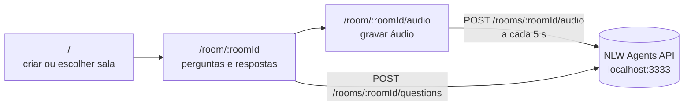

<div align="center">

# 🤖 NLW Agents — Front-end

**Salas de perguntas e respostas com gravação de áudio, onde uma IA responde com base no conteúdo gravado.**


</div>

---

## 💡 Sobre

Interface web do NLW Agents: crie uma sala, grave o áudio de uma aula ou conversa direto do navegador e faça perguntas — a IA responde usando apenas o que foi gravado naquela sala. Desenvolvido durante o **NLW Agents** da Rocketseat e consome a API do [NLW-Agents-Back](https://github.com/KevinLopes23/NLW-Agents-Back).

## ✨ Funcionalidades

- 🏠 Criação de salas e listagem com contagem de perguntas
- 🎙️ Gravação de áudio no navegador (`MediaRecorder`, `audio/webm`) com envio em blocos de 5 segundos
- 💬 Perguntas com atualização otimista e indicador de "gerando resposta"
- 🤖 Respostas da IA exibidas na sala, com datas relativas (Day.js)
- ✅ Formulários com React Hook Form + Zod

## 🛠️ Tecnologias

React 18 · TypeScript · Vite · Tailwind CSS 4 · shadcn/ui (Radix) · TanStack Query · React Router · React Hook Form · Zod · Day.js · Lucide · Biome

## 🔄 Fluxo



## 🧭 Páginas

| Rota | Descrição |
|---|---|
| `/` | Criação de sala e lista de salas existentes |
| `/room/:roomId` | Perguntas e respostas da sala |
| `/room/:roomId/audio` | Gravação do áudio da sala |

## 🚀 Como rodar

Pré-requisitos: Node.js 18+ e o [back-end](https://github.com/KevinLopes23/NLW-Agents-Back) rodando em `http://localhost:3333`.

```bash
npm install
npm run dev
```

Acesse `http://localhost:5173`. A URL da API está fixa em `src/http/*` e `src/pages/record-room-audio.tsx` (`http://localhost:3333`).

Build de produção: `npm run build` (gera `dist/`) e `npm run preview`.

## 📄 Licença

Distribuído sob a licença MIT. Veja [`LICENSE`](LICENSE).

## 👤 Autor

Feito por [Kevin Lopes](https://github.com/KevinLopes23)
